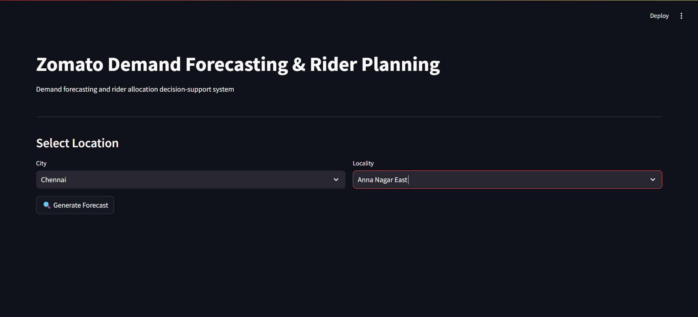
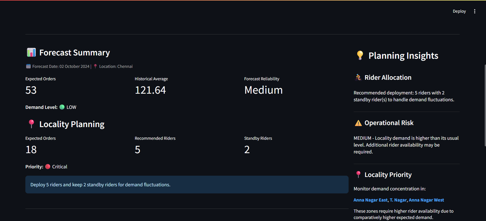
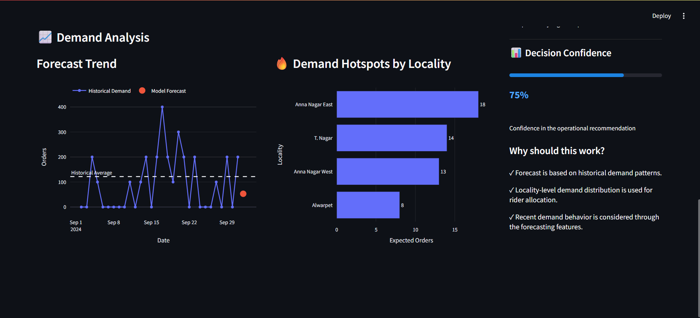
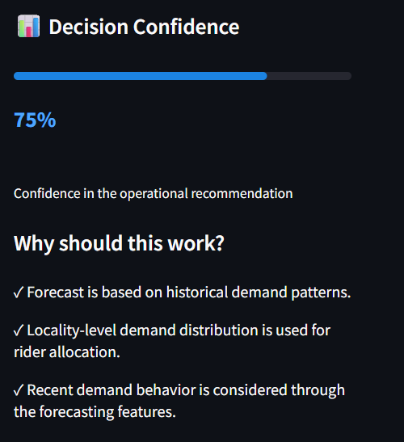

# Zomato Demand Forecasting & Rider Planning

An end-to-end **demand forecasting and operational decision-support
system** that converts historical food-delivery demand into
**locality-level rider planning recommendations**.

> **Main idea: Forecast demand → identify where demand is concentrated →
> plan rider capacity → assess risk and confidence → communicate an
> actionable operational decision.**

------------------------------------------------------------------------
## 🚀 Live Demo

**Try the deployed Streamlit dashboard:** [Zomato Demand Forecasting & Rider Planning](https://zomato-demand-forecasting-rider-planning.streamlit.app/)

The dashboard lets users select a city and locality, generate demand forecasts, and explore rider allocation recommendations based on historical operational data.

## 🚀 Project Overview

Food-delivery demand can vary significantly across cities and
localities. A city-level forecast tells us **how much demand is
expected**, but operations also need to know where that demand is
concentrated and how much rider capacity should be available.

This case study connects **machine-learning forecasting with operational
planning**. The system takes historical order data, forecasts upcoming
demand, distributes the forecast across operational localities,
estimates active and standby rider requirements, identifies priority
zones, assesses operational risk and decision confidence, and presents
the result through an interactive **Streamlit decision-support
interface**.

### The core idea

This project does **not stop at**:

> **"How many orders are expected?"**

It continues to:

> **"Where is the demand expected?"**\
> ↓\
> **"How much rider capacity is required?"**\
> ↓\
> **"Which zones need priority?"**\
> ↓\
> **"What operational action should be taken?"**

That prediction-to-action flow is the main idea behind both the case
study and the interface.

------------------------------------------------------------------------

## 🎯 Business Problem

A city-level demand forecast alone is not sufficient for delivery
operations.

The system is designed to answer:

-   How much demand is expected?
-   Which localities are likely to contribute more demand?
-   Which zones need higher operational priority?
-   How many riders should be deployed?
-   How much standby capacity should be maintained?
-   How reliable is the recommendation?
-   What should happen when sufficient historical locality data is
    unavailable?

------------------------------------------------------------------------

## 💡 Solution Approach

``` text
Historical Order Data
        ↓
Data Preparation & Validation
        ↓
Daily Demand Aggregation
        ↓
Feature Engineering
        ↓
Demand Forecasting
        ↓
Locality Demand Scoring
        ↓
Locality Forecast Allocation
        ↓
Rider & Standby Planning
        ↓
Priority + Risk + Confidence
        ↓
Operational Recommendation
        ↓
Streamlit Decision-Support Dashboard
```

The important design principle is to **translate a prediction into an
operational decision**, rather than presenting a forecast in isolation.

------------------------------------------------------------------------

## 🧠 Methodology

### 1. Data Preparation

Historical order data is cleaned, standardized and validated before
modelling. The preparation workflow includes:

-   Required-field validation
-   Missing-value examination
-   Duplicate checking
-   Date consistency checks
-   City and locality validation
-   Daily demand aggregation

### 2. Demand Forecasting

Orders are aggregated at the daily level and forecasting features are
created to capture both historical and recent demand behaviour.

Features include:

-   Lag 1 day
-   Lag 7 days
-   Lag 30 days
-   Rolling mean
-   Rolling standard deviation
-   Calendar/time features
-   Recent demand behaviour

Different forecasting approaches were evaluated during model
development, with **XGBoost** selected for the final forecasting
workflow.

### 3. Locality-Level Demand Planning

The city-level forecast is translated into locality-level expected
demand. The framework considers historical locality demand and recent
locality behaviour to identify operationally important zones.

The locality demand score gives greater importance to established
historical demand while also incorporating recent behaviour:

``` text
75% Historical Demand
+
25% Recent Demand
```

The dashboard highlights demand hotspots and higher-priority localities.

### 4. Rider Planning

The locality-level demand is converted into operational capacity
recommendations using predefined planning rules.

The system produces:

-   Expected orders
-   Recommended riders
-   Standby riders
-   Locality priority
-   Operational risk
-   Decision confidence
-   Final deployment recommendation

This is the bridge between the **ML prediction** and the **business
decision**.

------------------------------------------------------------------------

## ⚠️ Data Sufficiency & the 30-Record Rule

A key part of the case study is handling sparse locality data
responsibly.

A minimum of **30 historical records** is required for locality-level
operational forecasting.

``` text
30 or more records
        ↓
Locality-level forecast
        ↓
Rider planning recommendation

Less than 30 records
        ↓
Insufficient historical evidence
        ↓
Do not generate an unsupported locality forecast
```

This prevents a locality with very limited historical information from
being treated as though it has the same forecasting reliability as a
well-supported locality.

The interface explicitly communicates the insufficient-data situation
instead of hiding it behind an unreliable number.

------------------------------------------------------------------------

## 🖥️ Interactive Decision-Support Interface

The final output is an interactive **Streamlit dashboard** designed
around the operational workflow.

### Dashboard Home

The user selects a **city** and **locality**, then generates the
forecast.



### Forecast Summary & Locality Planning

The interface presents the forecast date, expected orders, historical
average, forecast reliability, locality-level expected orders,
recommended riders and standby capacity.



### Planning Insights

The planning panel summarizes:

-   Rider allocation
-   Operational risk
-   Locality priority
-   Decision confidence

This makes the analytical output easier for an operations-oriented user
to interpret.

### Demand Analysis

The dashboard provides historical demand trends, model forecast
information and locality-level demand hotspots.



### Decision Confidence

The interface communicates confidence in the operational recommendation
and provides supporting reasoning.



### Insufficient-Data Handling

The application also handles localities where sufficient historical
records are unavailable instead of producing an unsupported operational
recommendation.


------------------------------------------------------------------------

## 📊 Key Outputs

  Output                      Purpose
  --------------------------- -----------------------------------
  Expected Orders             Forecasted demand
  Historical Average          Comparison with historical demand
  Forecast Reliability        Indicates reliability level
  Locality Demand             Expected demand by locality
  Demand Hotspots             Identifies high-demand zones
  Recommended Riders          Active rider requirement
  Standby Riders              Buffer capacity
  Locality Priority           Operational prioritization
  Operational Risk            Demand-related operational risk
  Decision Confidence         Confidence in the recommendation
  Deployment Recommendation   Final actionable decision

------------------------------------------------------------------------

## 🛠️ Technology Stack

-   **Python**
-   **Pandas**
-   **NumPy**
-   **Scikit-learn**
-   **XGBoost**
-   **Matplotlib**
-   **Streamlit**
-   **Joblib**
-   **Jupyter Notebook**

------------------------------------------------------------------------

## 📁 Project Structure

``` text
Zomato-Demand-Forecasting-Rider-Planning/
│
├── app.py
├── backend.py
├── forecast_model.pkl
├── requirements.txt
├── README.md
├── .gitignore
│
├── datasets/
│
├── notebooks/
│   ├── Data_Preparation_and_Model_Selection.ipynb
│   └── Demand_Forecasting_Development.ipynb
│
├── report/
│
├── presentation/
│
└── screenshots/
    ├── 01_dashboard_home.png
    ├── 02_forecast_summary.png
    ├── 03_demand_analysis.png
    ├── 04_decision_confidence.png
    ├── 05_insufficient_data_summary.png
    └── 06_insufficient_data_analysis.png
```

------------------------------------------------------------------------

## ▶️ Run the Application Locally

### 1. Clone the repository

``` bash
git clone <your-github-repository-url>
cd Zomato-Demand-Forecasting-Rider-Planning
```

### 2. Install dependencies

``` bash
pip install -r requirements.txt
```

### 3. Add the dataset

The cleaned dataset used for the case study is not included in the
public repository.

Place the required dataset at the location expected by the
application/backend. Check the dataset path used in `backend.py` if the
filename or location differs from your local copy.

### 4. Run the Streamlit application

``` bash
python -m streamlit run app.py
```

The application will normally be available at:

``` text
http://localhost:8501
```

------------------------------------------------------------------------

## 📚 Repository Documentation

The repository contains the supporting material needed to understand and
reproduce the case study.

### `notebooks/`

Contains development work for data preparation, exploratory analysis,
model selection, feature engineering and demand forecasting.

### `report/`

Contains the detailed case-study report covering the problem,
methodology, assumptions, development, results, limitations and
conclusions.

### `presentation/`

Contains the project presentation covering the business problem,
analytical approach, solution, results and dashboard.

### `screenshots/`

Provides visual evidence of the working Streamlit interface, including
successful forecasts and insufficient-data handling.

------------------------------------------------------------------------

## 📌 Key Assumptions

-   A minimum of 30 historical records is required for locality-level
    operational forecasting.
-   Historical locality demand receives greater weight than recent
    demand.
-   Recent demand behaviour is also incorporated into locality scoring.
-   The highest-ranked demand localities are treated as primary
    operational zones.
-   Locality allocation uses predefined planning assumptions.
-   Rider and standby requirements are derived using predefined
    operational rules rather than real-time fleet optimization.
-   The forecasting horizon is daily rather than hourly.
-   The system is based on historical demand information rather than
    live operational data.

------------------------------------------------------------------------

## ⚠️ Limitations

This project is designed as a **case-study decision-support framework**,
not a production fleet-optimization system.

The current approach does not explicitly model:

-   Real-time rider availability
-   Traffic conditions
-   Weather
-   Promotions and campaigns
-   Restaurant preparation times
-   Hourly demand peaks
-   Real-time order inflow
-   Exact geographic travel time between zones

Therefore, rider recommendations should be interpreted as **analytical
planning recommendations based on historical demand and predefined
operational assumptions**.

------------------------------------------------------------------------

## 🔮 Future Scope

Potential extensions include:

-   Hourly demand forecasting
-   Real-time demand updates
-   Weather and event features
-   Traffic-aware rider planning
-   Restaurant-level demand prediction
-   Dynamic rider reallocation
-   Geospatial optimization
-   Optimization-based rider allocation
-   Live operational-system integration
-   Automated model monitoring and retraining

------------------------------------------------------------------------

## 🎯 Project Takeaway

The central takeaway is:

> **Prediction is useful only when it can support a decision.**

This project therefore combines:

``` text
Machine Learning
      +
Demand Analysis
      +
Locality Intelligence
      +
Rider Planning
      +
Operational Risk
      +
Decision Confidence
      =
Actionable Decision Support
```

The final Streamlit interface demonstrates this complete flow:

**Forecast demand → identify demand concentration → determine rider
capacity → prioritize localities → communicate the operational action.**

The result is an **end-to-end analytics and decision-support case
study**, rather than only a machine-learning forecasting exercise.

------------------------------------------------------------------------

## 👨‍💻 Author

**Yaswanth Yadala**

**Zomato Demand Forecasting & Rider Planning --- Case Study**
